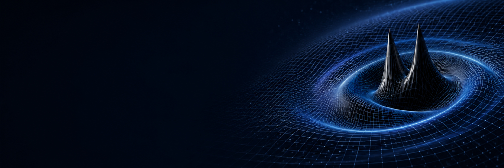
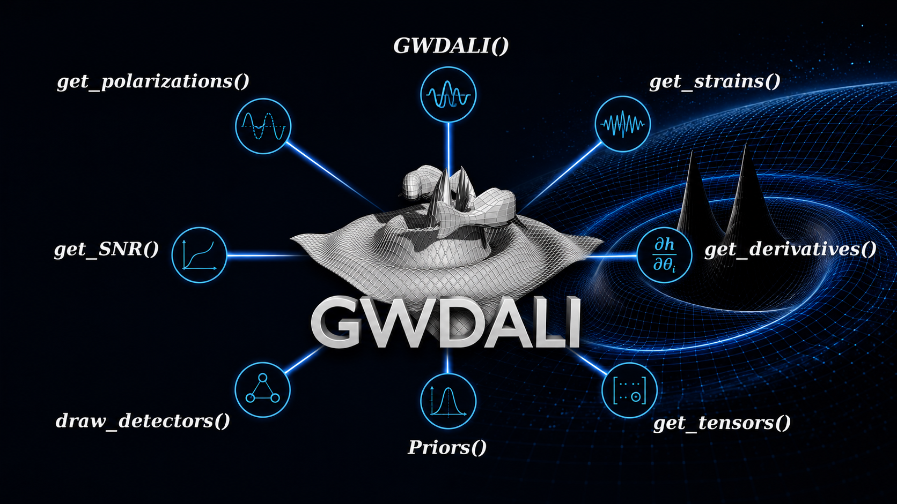

::: {.gwdali-banner}
{.banner-img}

::: {.banner-overlay}
# GWDALI 1.0
### Gravitational-Wave Inference Beyond the Fisher Approximation
:::
:::

::: {.content-wrapper-page}

## Overview

**GWDALI** (Gravitational Wave Derivative Approximation for Likelihoods) is an open-source Python package developed to perform **parameter estimation of gravitational wave (GW) sources beyond the standard Gaussian (Fisher Matrix) approximation**, using the **Derivative Approximation for Likelihoods (DALI)** method.

GWDALI 1.0 is the culmination of work published in two peer-reviewed papers:

- de Souza, J. M. S., & Sturani, R. (2023). *Astronomy and Computing*, 45, 100759. [arXiv:2307.10154](https://arxiv.org/abs/2307.10154)
- de Souza, J. M. S., & Quartin, M. (2026). *JCAP*, 2026(05), 101. [arXiv:2510.16955](https://arxiv.org/abs/2510.16955)

---

## Motivation

GW parameter estimation is a challenging problem: a compact binary coalescence (CBC) signal is described by **15 physical parameters** (masses, spins, sky position, luminosity distance, orientation, etc.), and the GW waveform models are computationally expensive.

The standard approach — the **Fisher Matrix** — approximates the likelihood as a multivariate Gaussian. This works well at high signal-to-noise ratio (SNR), but **fails for few-detector networks** and strongly correlated parameters such as the luminosity distance $d_L$ and inclination angle $\iota$. In those regimes, Fisher-based posteriors can be orders of magnitude off from the exact likelihood.

**DALI** solves this by extending the Taylor expansion of the log-likelihood to higher orders, capturing non-Gaussian features of the posterior at a **fraction of the computational cost of MCMC**.

---

## The DALI Method

DALI expands the log-likelihood beyond the Fisher (quadratic) level:

$$
\log\mathcal{L} \approx -\frac{1}{2}\sum_{i,j}\langle \partial_i h | \partial_j h \rangle_0 \Delta\theta^i \Delta\theta^j \quad \text{[Fisher]}
$$
$$
- \frac{1}{2}\sum_{i,j,k}\langle \partial_i h | \partial_{jk} h \rangle_0 \Delta\theta^{ijk} + \frac{1}{8}\sum_{i,j,k,l}\langle \partial_{ij} h | \partial_{kl} h \rangle_0 \Delta\theta^{ijkl} \quad \text{[Doublet]}
$$
$$
- \frac{1}{6}\sum_{i,j,k,l}\langle \partial_i h | \partial_{jkl} h \rangle_0 \Delta\theta^{ijkl} + \cdots \quad \text{[Triplet]}
$$

GWDALI implements **Fisher**, **Doublet** and **Triplet** orders, with support for automatic differentiation (JAX) and numerical derivatives.

---

## Key Functionalities

GWDALI provides a modular Python API centered on the `GWDALI()` class:

| Function | Description |
|---|---|
| `get_polarizations()` | Compute GW polarizations $h_+$, $h_\times$ |
| `get_strains()` | Compute detector strains $F_+h_+ + F_\times h_\times$ |
| `get_SNR()` | Compute signal-to-noise ratio |
| `get_derivatives()` | Waveform derivatives $\partial h / \partial\theta_i$ (numerical or JAX autodiff) |
| `get_tensors()` | Fisher, Doublet and Triplet tensors |
| `Priors()` | Define and sample prior distributions |
| `draw_detectors()` | Visualize detector network geometry |

---

## Detector Networks & Sensitivities

GWDALI supports **user-defined detector networks**, with built-in sensitivity curves for:

- **Einstein Telescope (ET)** — triangular 10 km detector
- **Cosmic Explorer (CE)** — 20 km and 40 km L-shaped detectors
- **LIGO**, **Virgo**, **KAGRA**

Users can also supply custom sensitivity curves as `(freq, Sn)` arrays, enabling forecasts for any proposed detector configuration.

---

## Waveform Approximants

GWDALI includes **JAX-friendly** implementations (translated from LAL-C) for automatic differentiation:

- `TaylorF2`
- `IMRPhenomA`, `B`, `C`, `D`, `HM`

For broader coverage, all **LALSimulation** waveforms are accessible via `lalsimulation`, with numerical derivatives computed automatically.

---

## GW Source Parameters

GWDALI characterizes CBC sources through 15 physical parameters:

| Parameter | Symbol |
|---|---|
| Luminosity Distance | $d_L$ |
| Inclination | $\iota$ |
| Chirp Mass | $\mathcal{M}_c$ |
| Symmetric Mass Ratio | $\eta$ |
| Right Ascension | $\alpha$ |
| Declination | $\delta$ |
| Polarization Angle | $\psi$ |
| Coalescence Phase | $\phi_c$ |
| Coalescence Time | $t_c$ |
| Spins (x, y, z) of each object | $\vec{\chi}_1$, $\vec{\chi}_2$ |

---

## Installation

```bash
pip install gwdali
```

Full documentation and Jupyter notebook examples are available at:

- 📖 **Docs:** [gwdali.readthedocs.io](https://gwdali.readthedocs.io/)
- 📦 **PyPI:** [pypi.org/project/gwdali](https://pypi.org/project/gwdali/)

---

## Jupyter Notebook Examples

GWDALI ships with worked examples covering all major functionalities:

1. `1_get_hphx.ipynb` — Compute GW polarizations
2. `2_drawDetectors.ipynb` — Visualize detector networks
3. `3_get_strains.ipynb` — Compute detector output
4. `4_get_derivatives.ipynb` — Waveform derivatives (numerical & JAX)
5. `5_get_tensors.ipynb` — Fisher, Doublet and Triplet tensors
6. `6_GWDALI_MCMC_Fisher-vs-Single.ipynb` — Full posterior comparison (Fisher vs. DALI vs. MCMC)

---

## Results & Validation

GWDALI has been validated against exact MCMC posteriors using **Jensen–Shannon divergence** as a metric. For 300 simulated BBH detections with the Einstein Telescope (SNR > 8):

- **Fisher (inversion)** often fails for parameters such as $d_L$ and $\iota$ due to strong correlations
- **DALI Doublet** significantly improves the posterior approximation over Fisher
- **DALI Triplet** further refines the approximation, approaching MCMC accuracy at much lower cost
- **Alternative parameterizations** (e.g., $1/d_L$, $1/d_L^2$) can extend DALI's validity range

---

## Conclusions & Outlook

- Traditional Fisher analysis **fails for GW posteriors** in low-SNR or strongly correlated regimes
- DALI provides a **computationally efficient alternative**, capturing non-Gaussian features
- GWDALI 1.0 is **fully open-source** and actively maintained
- Ongoing work: optimization of derivative computations (the main bottleneck), extension to all 15 GW parameters, and further validation against 3G detector networks



:::
