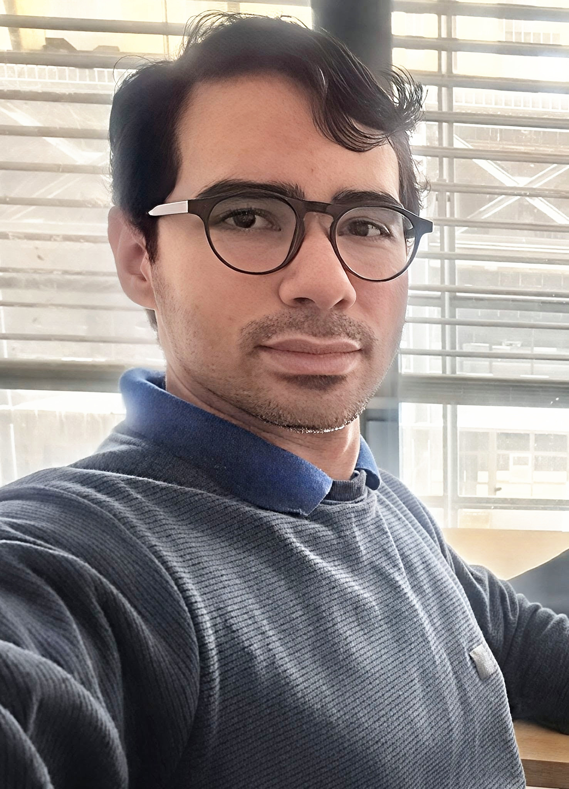

::: {.columns}

::: {.column width="70%"}
::: {.main-card}

## About Me

I am a **Postdoctoral Fellow** in Physics at the [**Núcleo Cosmo-UFES & PPGCosmo**](https://cosmo-ufes.org/), Universidade Federal do Espírito Santo (UFES), Brazil, funded by FAPES since 2025. I received my Ph.D. in Physics in 2023 from the Universidade Federal do Rio Grande do Norte (UFRN), with a specialization in Gravitation and Cosmology and a focus on Gravitational Waves.

I am a member of the **Einstein Telescope Observational Science Board (ET-OSB)** and the **Brazilian Einstein Telescope Synergy (BETS)**, and I collaborate on gravitational-wave research with the Brazilian Center for Physical Research (CBPF) and the National Institute for Space Research (INPE).

My research interests lie in **Cosmology** and the **Astrophysics of Gravitational Waves**, with a strong emphasis on numerical modeling, data analysis, and parameter estimation. I have extensive experience in Python and C programming, high-performance computing (HPC), and large-scale numerical simulations. I am the developer of [**GWDALI**](https://pypi.org/project/gwdali/), an open-source Python package available on PyPI, which implements the Derivative Approximation for Likelihoods (DALI) method for parameter estimation of gravitational-wave sources.

---

## Affiliation

| | |
|---|---|
| **Position** | Postdoctoral Fellow (FAPES) |
| **Institution** | Universidade Federal do Espírito Santo (UFES) |
| **Group** | Núcleo Cosmo-UFES & PPGCosmo |
| **Location** | Vitória, ES, Brazil |
| **Email** | [josiel.souza@ufes.br](mailto:josiel.souza@ufes.br) |

---

## Research Interests

- Cosmology with Gravitational Waves (Standard & Dark Sirens)
- Parameter Estimation beyond the Gaussian (Fisher) Approximation
- Derivative Approximation for Likelihoods (DALI)
- Third-Generation Gravitational Wave Detectors (Einstein Telescope, Cosmic Explorer)
- Numerical Modeling, HPC & Large-Scale Simulations
- Late-Time Cosmology & Hubble Tension

---

## Research Groups & Memberships

### Einstein Telescope Observational Science Board (ET-OSB)
Member since June 2022. Active in Div. 1 (Fundamental Physics), Div. 2 (Cosmology), and Div. 9 (Common Tools).

### Brazilian Einstein Telescope Synergy (BETS)
Member since January 2024. Contributing with improvements on the DALI approximation for Gravitational Wave Data Analysis and Cosmology.

---

## Selected Publications

**[2026]** Souza, J. M. S. and Miguel Quartin. *On the use of the Derivative Approximation for Likelihoods for gravitational wave inference.* JCAP 05 (2026), p. 101. [doi:10.1088/1475-7516/2026/05/101](https://doi.org/10.1088/1475-7516/2026/05/101)

**[2026]** Adrian Abac et al. *The Science of the Einstein Telescope.* JCAP 03 (2026), p. 081. [doi:10.1088/1475-7516/2026/03/081](https://doi.org/10.1088/1475-7516/2026/03/081)

**[2023]** Souza, J. M. S. and Riccardo Sturani. *GWDALI: A Fisher-matrix based software for gravitational wave parameter-estimation beyond Gaussian approximation.* Astron. Comput. 45 (2023), p. 100759. [doi:10.1016/j.ascom.2023.100759](https://doi.org/10.1016/j.ascom.2023.100759)

**[2023]** Souza, J. M. S. and Riccardo Sturani. *Luminosity distance uncertainties from gravitational wave detections of binary neutron stars by third generation observatories.* Phys. Rev. D 108.4 (2023), p. 043027. [doi:10.1103/PhysRevD.108.043027](https://doi.org/10.1103/PhysRevD.108.043027)

[→ Full list of publications](publications.qmd)

:::
:::

::: {.column width="5%"}
:::

::: {.column width="25%"}

::: {.sidebar-card}

{.profile-photo}

**Josiel M. S. de Souza**
Postdoctoral Fellow

Núcleo Cosmo-UFES & PPGCosmo
UFES · Vitória, Brazil

---

::: {.social-links}
[ ORCID](https://orcid.org/0000-0003-1552-0095)

[ GitHub](https://github.com/jmsdsouzaPhD)

[ LinkedIn](https://www.linkedin.com/in/josiel-mendon%C3%A7a-63a153224/)

[ Google Scholar](https://scholar.google.com.br/citations?user=QRp8XiAAAAAJ&hl=pt-BR&oi=sra)

[ josiel.souza@ufes.br](mailto:josiel.souza@ufes.br)
:::

:::

:::

:::
